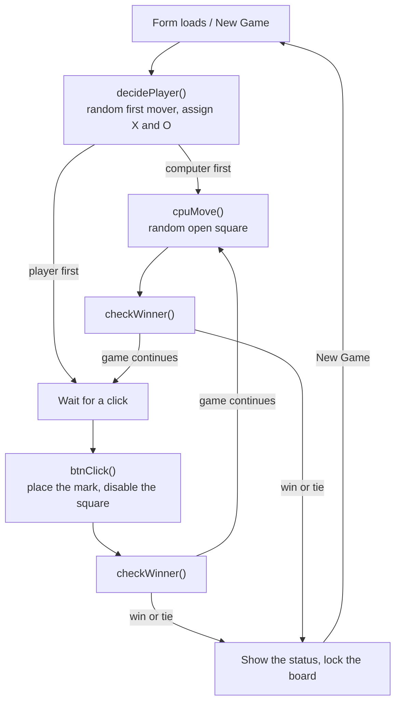

# Tic-Tac-Toe

A single-player Tic-Tac-Toe game against a computer opponent, built with **C# and Windows Forms on .NET Framework 4.7.2**, with the UI laid out in the Visual Studio designer.

This was a pair project (*Cs1Tic*) by **Manuel Rosales and Michael Tran** for **TINFO 200 (Programming II for IT, C#)** at the **University of Washington Tacoma**, Winter 2024.

```
┌─────┬─────┬─────┐
│  X  │  O  │     │
├─────┼─────┼─────┤
│     │  X  │  O  │
├─────┼─────┼─────┤
│     │     │  X  │
└─────┴─────┴─────┘
      X Wins!
[ New Game ]   [ Exit Game ]
```

---

## How it plays

- **Random turn order.** Each game randomly decides who moves first. Whoever starts plays **X**, so you might be X or O. If the computer starts, it moves immediately.
- **You click a square** to place your mark. The computer answers by picking a random open square.
- **Win detection** checks all 8 lines: 3 rows, 3 columns and 2 diagonals.
- **Status label** shows `X Wins!`, `O Wins!` or `Tie!`.
- **New Game** clears the board and re-rolls the turn order. **Exit Game** closes the app.

---

## Architecture

All the logic lives in one form, `Form1.cs`. The game state is a handful of fields: `turnCount`, `playerTurn`, `playerSign`, `cpuSign` and a shared `Random`.



- **One handler for nine squares.** All 9 board buttons share `btnClick`, which works out which square was clicked from `sender`.
- **The board is the state.** Each square's `Text` holds its mark, and its `Enabled` flag records whether it has been played. The computer chooses from `buttons.Where(b => b.Enabled)`.
- **Layout.** The board is a 3 × 3 `TableLayoutPanel` with percentage-sized cells, in a 30 pt Century Gothic font, with a custom window icon.

---

## Edge cases handled

- **No overwriting.** A square is disabled as soon as it's played, so it can't be clicked again.
- **No moving out of turn.** Clicks are ignored while it's the computer's turn (`if (!playerTurn) return;`).
- **No moves after the game ends.** A win disables every square, so the computer's follow-up move finds no open squares and does nothing.
- **A win on the last move is a win, not a tie.** Lines are checked before the 9-move tie condition.
- **Empty lines never count.** A line only wins if its first square has been played (`!btn.Enabled`), so three blank squares don't match.
- **The right winner is credited.** The winning mark is resolved from whose turn it was when the line completed.
- **Clean restarts.** New Game resets the move counter, the turn flag, every square and the status label, then re-randomizes who starts.

## Known limitations

- The computer plays randomly, without strategy. A minimax opponent would make it unbeatable.
- There's no score tracking across games.
- `disableButtons()` loops over the form's top-level controls, but the squares live inside the `TableLayoutPanel`, so the explicit per-square disabling right after it is what actually locks the board.

---

## Run it

**Requirements:** Windows and Visual Studio 2019 or 2022 with the *.NET desktop development* workload (.NET Framework 4.7.2).

1. Open `TicTacToe.sln`.
2. Press **F5**.

## Project structure

```
TicTacToe/
├── TicTacToe.sln / TicTacToe.csproj   WinExe targeting .NET Framework 4.7.2
├── Program.cs                         entry point and project header
├── Form1.cs                           game logic: turns, computer moves, win and tie detection
├── Form1.Designer.cs                  generated UI: 3 × 3 board, status label, buttons
├── Form1.resx                         form resources, including the window icon
└── Properties/                        assembly info, resources, settings
```

## Development log

From the change history in `Form1.cs`:

| Date | Developer | Change |
| --- | --- | --- |
| 2024-02-08 | Manuel Rosales | Created the application and the GUI |
| 2024-02-08 | Michael Tran | Implemented the game logic |
| 2024-02-09 | Manuel Rosales | Logic troubleshooting |
| 2024-02-10 | Manuel Rosales | Completed the game |

## Tech

C# · Windows Forms · .NET Framework 4.7.2 · LINQ · Visual Studio Designer
